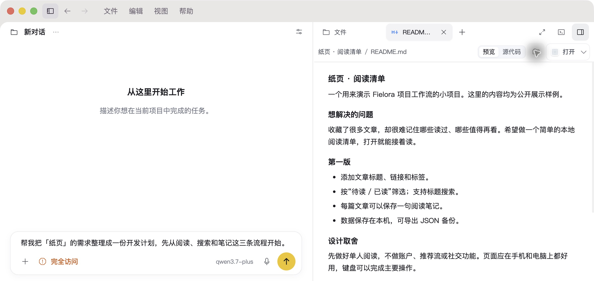
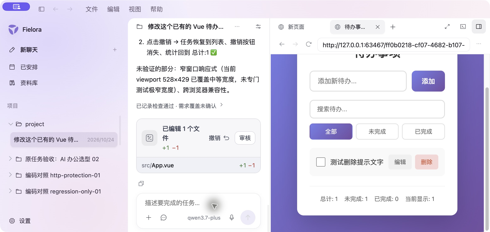
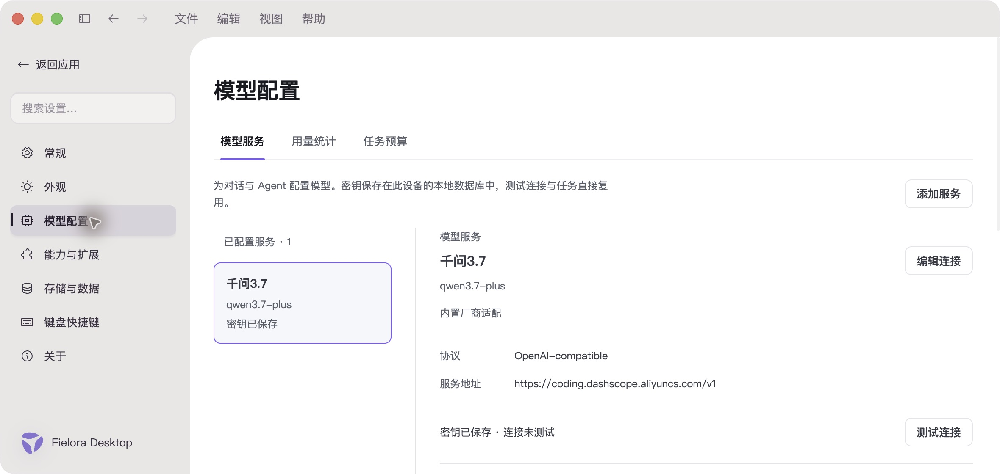
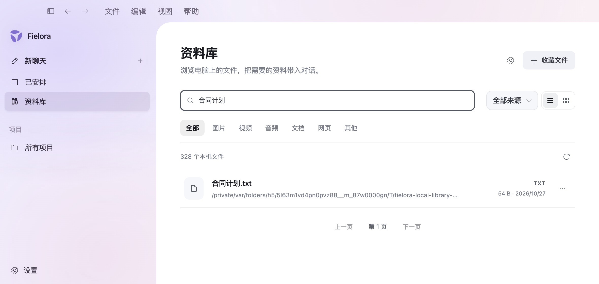

**Fielora is an open-source AI desktop workspace.** Bring conversations, files, models and tools together around a local project. Read documents, make code changes and inspect the results without losing the thread of your work.

[Quick start](#quick-start) · [Feature tour](#feature-tour) · [Documentation](docs/README.md) · [Development status](#development-status) · [简体中文](README.md)

[](LICENSE)
[](#development-status)
[](#technology)
[](#technology)

## What you can do

- **Keep work organized by project.** Connect a local folder, create multiple conversations and return to your files and work history.
- **Choose your model provider.** Use OpenAI Responses, Anthropic Messages or OpenAI-compatible services.
- **Let an agent do the work.** Read and search files, make edits and run commands, then inspect execution records and diffs.
- **Check the results directly.** Preview Markdown, open files and browse local or remote pages alongside the conversation.
- **Connect your tools.** Extend projects with Skills, local MCP stdio tools and configurable web search.
- **Bring in local material.** Save files and reference them in conversations. The 0.2.0 development preview adds folder indexing and filename search.

## Quick start

Fielora is currently for developers and early users running from source. Public installers are not available yet. Use the development branch; product code on `main` is an older baseline.

### 1. Prepare your environment

| Dependency | Version / requirement |
| --- | --- |
| Node.js | 24.18.1 |
| pnpm | 11.21.0 |
| Rust | 1.97.1 |
| macOS Apple Silicon | Xcode Command Line Tools |
| Windows 11 x64 | MSVC C++ tools and Windows SDK |

### 2. Clone and run

```sh
git clone --branch phase/complete-agent-v0.1 https://github.com/Moriaenzhx/Fielora.git
cd Fielora
pnpm install --frozen-lockfile
pnpm dev
```

The first launch builds the Rust Core and opens the Electron desktop app. See the [macOS development guide](https://github.com/Moriaenzhx/Fielora/blob/b5ac134b5fe934f1ba0c97682b9ed8dbbf358d06/docs/engineering/MACOS_DEVELOPMENT.md) for platform setup.

### 3. Start a task

Open **Settings → Model configuration**, add your service URL, API key and model name, then open a local project folder and create a conversation. Start with a small request:

> Read this project's README. Explain how to run it and where the main code lives.

For changes, describe the expected behavior and review the diff and actual results. Model requests use your own provider account and quota.

## Feature tour

These are real Fielora desktop captures from different development versions. See [screenshot notes](docs/media/showcase/README.md) for dates, examples and what each capture demonstrates.

| Workflow | What it provides |
| --- | --- |
| Projects and conversations | Persistent conversations around local files |
| Coding and review | File search, edits, command execution, diffs and output |
| Files and browser | Markdown previews, files, websites and local pages |
| Models and extensions | Your own model services, Skills, MCP and search tools |
| Local library preview | Filename search, original-file access and conversation references |

### 01 · Conversations beside your files

Discuss a task while reading the actual document. Open the file tree, source or rendered Markdown as needed.



<sub>A public reading-list example. The request on the left is an unsent draft; the right side shows the actual file.</sub>

### 02 · From a code change to a working page

Inspect execution records, file changes and a running page together. Review the diff or try the interaction in the built-in browser before continuing.



<sub>A real Qwen task fixing a deleted-item message and checking deletion and undo. The capture retains the scope of the checks.</sub>

### 03 · Your choice of models and tools

Configure model services, compatible endpoints, capabilities and reasoning settings in one place. Usage and task budgets are available alongside them.



Projects can load Skills and local MCP tools. Web search supports Exa, Brave Search and compatible SearXNG services. Authorized macOS application control and window observation are also available; see the [computer-control guide](https://github.com/Moriaenzhx/Fielora/blob/b5ac134b5fe934f1ba0c97682b9ed8dbbf358d06/docs/product/COMPUTER_CONTROL_AND_PERMISSION_V0.1.md).

### 04 · Local file library · Development preview

Index selected folders, find files by name, open or locate the originals, and add references to a conversation. Files stay where they are.



<sub>Captured from a local 0.2.0 packaged build using isolated test files. The new indexing feature has not yet been pushed to the public development branch.</sub>

The index currently covers filenames and metadata. Content extraction depends on the file format; semantic photo search, video understanding and whole-disk content Q&A are outside this version's scope.

## Documentation

- [macOS setup](https://github.com/Moriaenzhx/Fielora/blob/b5ac134b5fe934f1ba0c97682b9ed8dbbf358d06/docs/engineering/MACOS_DEVELOPMENT.md)
- [Web search configuration](https://github.com/Moriaenzhx/Fielora/blob/b5ac134b5fe934f1ba0c97682b9ed8dbbf358d06/docs/product/WEB_SEARCH_SETUP.md)
- [Computer control and permissions](https://github.com/Moriaenzhx/Fielora/blob/b5ac134b5fe934f1ba0c97682b9ed8dbbf358d06/docs/product/COMPUTER_CONTROL_AND_PERMISSION_V0.1.md)
- [Agent architecture](https://github.com/Moriaenzhx/Fielora/blob/b5ac134b5fe934f1ba0c97682b9ed8dbbf358d06/docs/architecture/AGENT_ENGINEERING_VIEWS_V0.1.md)
- [Contributing](CONTRIBUTING.md)
- [Documentation index](docs/README.md)

Most engineering documentation is currently in Chinese.

## Technology

**Electron, React and TypeScript** provide the desktop workspace. **Rust** handles model access, task execution, tools and persistence. **SQLite** stores local data.

```text
apps/desktop/          Desktop UI, browser and native integration
crates/                Rust Core, models, tools, storage and contracts
packages/contracts/    Shared TypeScript contracts
tests/                 Integration and desktop tests
docs/                  Usage, design and development documentation
```

<details>
<summary><strong>Data and execution</strong></summary>

- Project records, conversations and execution state are stored locally. Requests to external models are sent to your selected provider. Local LLMs are not currently supported.
- API keys are stored in the device's SQLite database without database encryption. Portable exports remove keys; protect local databases and backups.
- Task permissions control execution. Full access uses the current user's privileges and does not provide a command sandbox.
- Tool use, vision and long-task quality vary by model. Complex tasks, recovery and cross-platform behavior remain under active testing.

</details>

## Development status

The public development baseline is [`b5ac134`](https://github.com/Moriaenzhx/Fielora/commit/b5ac134b5fe934f1ba0c97682b9ed8dbbf358d06) on `phase/complete-agent-v0.1`. The 0.2.0 local library exists in a local implementation; voice and mobile control are experiments. These are not public stable releases.

Current priorities are task completion, context and recovery for long tasks, file and preview workflows, and platform regression testing before distributing installers. macOS Apple Silicon is the active local development environment; recent changes need further Windows 11 x64 regression testing. Linux and Intel Mac support are not promised.

## Contributing

[Report an issue](https://github.com/Moriaenzhx/Fielora/issues/new/choose), share a use case, improve the docs or contribute code. Start with the [contribution guide](CONTRIBUTING.md). Reproduction steps and real screenshots help with UI issues.

## License and acknowledgements

The MIT License permits commercial use, modification and redistribution of Fielora’s source code and documentation. Copies or substantial portions of the software must include the copyright and permission notices. Third-party components retain their own licenses. See the [license text](LICENSE) and [project attribution](NOTICE).

Thanks to Electron, React, Rust, SQLite, CodeMirror and Phosphor Icons. Documentation diagrams use [Archify](https://github.com/tt-a1i/archify); see [sources and licenses](https://github.com/Moriaenzhx/Fielora/blob/b5ac134b5fe934f1ba0c97682b9ed8dbbf358d06/docs/diagrams/README.md). The README structure was informed by [Yuxi](https://github.com/xerrors/Yuxi), using Fielora's own branding and real application captures.
