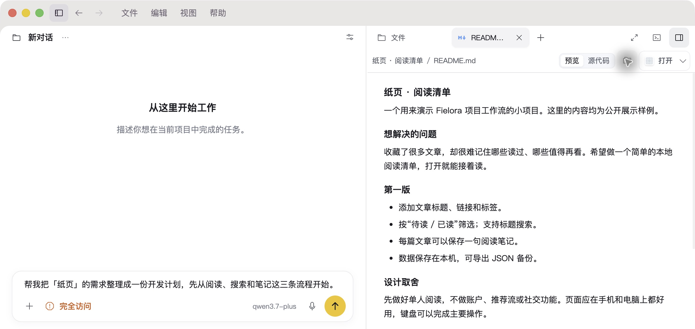
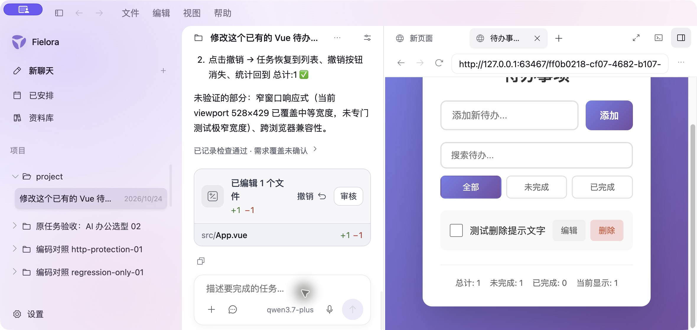
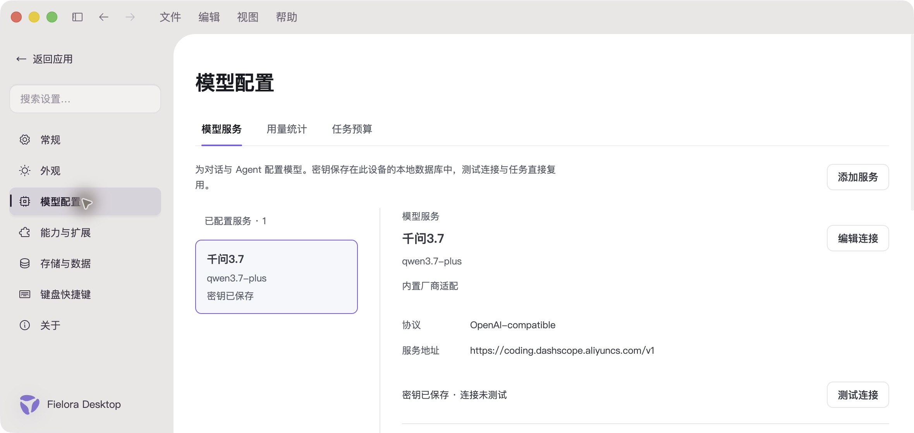
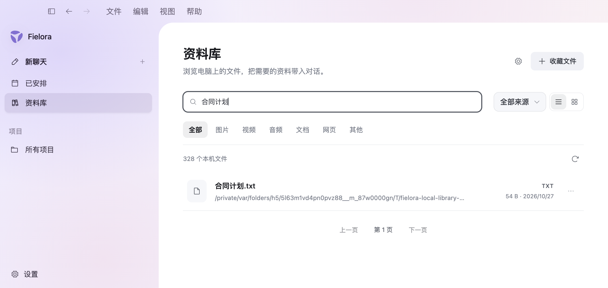

**Fielora 是一个开源的 AI 桌面工作空间。** 围绕本地项目，把对话、文件、模型和工具放在一起。从读懂一份资料、修改一段代码，到打开页面检查结果，都可以在同一个窗口里继续。

[快速开始](#快速开始) · [功能展示](#功能展示) · [文档](docs/README.md) · [开发进展](docs/DEVELOPMENT_STATUS.md) · [English](README.en.md)

[](LICENSE)
[](docs/DEVELOPMENT_STATUS.md)
[](#技术栈)
[](#技术栈)

## Fielora 能做什么

- **围绕项目持续工作**：连接本地文件夹，创建多个对话，保留文件上下文和工作记录。
- **选择自己的模型**：接入 OpenAI Responses、Anthropic Messages 或 OpenAI-compatible 服务，在对话中选择模型。
- **让 Agent 动手**：读取和搜索文件、修改代码、运行命令，再查看执行记录与文件 Diff。
- **直接检查结果**：在工作区预览 Markdown、打开文件或网页，把结果和对话放在一起看。
- **连接常用工具**：通过项目 Skill、本地 MCP stdio 和可配置的联网搜索扩展任务能力。
- **使用本机资料**：收藏文件并带入对话；0.2.0 开发预览进一步加入文件夹索引与文件名搜索。

## 快速开始

目前面向愿意从源码运行的开发者和早期使用者，公开安装包暂未开放。请使用开发分支；默认 `main` 的产品代码较旧。

### 1. 准备环境

| 依赖 | 版本 / 要求 |
| --- | --- |
| Node.js | 24.18.1 |
| pnpm | 11.21.0 |
| Rust | 1.97.1 |
| macOS Apple Silicon | Xcode Command Line Tools |
| Windows 11 x64 | MSVC C++ 工具链与 Windows SDK |

### 2. 获取代码并启动

```sh
git clone --branch phase/complete-agent-v0.1 https://github.com/Moriaenzhx/Fielora.git
cd Fielora
pnpm install --frozen-lockfile
pnpm dev
```

首次启动会编译 Rust Core，再打开 Electron 桌面窗口。Mac 的环境配置与常见问题见[开发指南](https://github.com/Moriaenzhx/Fielora/blob/b5ac134b5fe934f1ba0c97682b9ed8dbbf358d06/docs/engineering/MACOS_DEVELOPMENT.md)。

### 3. 开始第一个任务

打开 **设置 → 模型配置**，填写服务地址、API Key 和模型名称。然后添加本地项目文件夹，创建对话，试试：

> 读一下这个项目的 README，告诉我怎样运行它，以及主要代码在哪里。

需要修改时，再提出具体目标，并检查文件差异和实际运行结果。模型调用使用你自己的服务与额度。

## 功能展示

以下均为真实 Fielora 桌面截图。不同画面对应不同开发版本；拍摄时间、样例内容和运行范围见[截图说明](docs/media/showcase/README.md)。

| 工作方式 | 你可以做什么 |
| --- | --- |
| 项目与对话 | 持久保存对话，围绕同一份本地资料继续工作 |
| 编码与审阅 | 读取、搜索、修改文件，运行命令，检查 Diff 和输出 |
| 文件与浏览器 | 预览 Markdown、查看文件、打开网页与本地页面 |
| 模型与扩展 | 自带模型服务，配置 Skill、MCP 和搜索工具 |
| 本机资料库预览 | 按文件名找资料，定位原文件，放入已有对话 |

### 01 · 项目、对话与文件同屏

在一边讨论任务，在另一边查看实际文件。文件目录、源码和预览按需展开，处理资料时不必不断切换窗口。



<sub>公开样例「纸页 · 阅读清单」。左侧为未发送的任务草稿，右侧为实际文件预览。</sub>

### 02 · 从代码修改到页面检查

Agent 的执行记录、文件变更和运行页面可以并排查看。修改后打开 Diff，或在内置浏览器里检查交互，再决定下一步。



<sub>真实 Qwen 任务：修复 Vue 待办的删除提示，并检查删除与撤销。画面保留了本次检查的范围。</sub>

### 03 · 模型和工具由你选择

模型服务集中配置，支持兼容接口、自定义服务地址、模型能力与推理设置。用量与任务预算也在同一处查看。



项目可以加载 Skill、接入本地 MCP 工具；联网搜索支持 Exa、Brave Search 和 SearXNG 兼容服务。macOS 还提供经授权的应用操作与窗口观察，具体要求见[电脑控制说明](https://github.com/Moriaenzhx/Fielora/blob/b5ac134b5fe934f1ba0c97682b9ed8dbbf358d06/docs/product/COMPUTER_CONTROL_AND_PERMISSION_V0.1.md)。

### 04 · 本机文件资料库 · 开发预览

选择文件夹建立索引，按文件名查找资料，打开或定位原文件，再将需要的文件带入对话。原文件保留在原来的位置。



<sub>0.2.0 本机打包版本实拍，使用隔离的测试文件。这项新增索引功能尚未同步到公开开发分支。</sub>

当前索引以文件名和元数据为主；正文提取按格式提供支持。照片语义搜索、视频理解和全盘内容问答不在这一版范围内。

## 文档

| 我想了解 | 从这里开始 |
| --- | --- |
| 如何配置开发环境 | [macOS 开发指南](https://github.com/Moriaenzhx/Fielora/blob/b5ac134b5fe934f1ba0c97682b9ed8dbbf358d06/docs/engineering/MACOS_DEVELOPMENT.md) |
| 如何接入联网搜索 | [联网搜索设置](https://github.com/Moriaenzhx/Fielora/blob/b5ac134b5fe934f1ba0c97682b9ed8dbbf358d06/docs/product/WEB_SEARCH_SETUP.md) |
| 电脑控制需要哪些权限 | [电脑控制与权限](https://github.com/Moriaenzhx/Fielora/blob/b5ac134b5fe934f1ba0c97682b9ed8dbbf358d06/docs/product/COMPUTER_CONTROL_AND_PERMISSION_V0.1.md) |
| Agent 如何组织模型和工具 | [Agent 架构](https://github.com/Moriaenzhx/Fielora/blob/b5ac134b5fe934f1ba0c97682b9ed8dbbf358d06/docs/architecture/AGENT_ENGINEERING_VIEWS_V0.1.md) |
| 当前做到哪里、接下来做什么 | [开发进展](docs/DEVELOPMENT_STATUS.md) |
| 如何提交问题或代码 | [贡献指南](CONTRIBUTING.md) |

更多资料见[文档导航](docs/README.md)。

## 技术栈

**Electron + React + TypeScript** 构建桌面工作区，**Rust** 负责模型接入、任务执行、工具与持久化，**SQLite** 保存本机数据。

```text
apps/desktop/          桌面界面、浏览器与原生集成
crates/                Rust Core、模型、工具、存储与契约
packages/contracts/    TypeScript 共享契约
tests/                 集成与桌面测试
docs/                  使用、设计与开发文档
```

<details>
<summary><strong>数据与执行说明</strong></summary>

- 项目记录、对话和执行状态保存在本机。使用外部模型时，请求内容会发送到所选服务；目前不支持本地 LLM。
- API Key 保存在本机 SQLite 数据库中，未做数据库加密；可移植导出会剔除密钥。请保护好数据库与备份。
- 任务执行受权限设置控制。“完全访问”使用当前用户权限执行操作，不提供命令沙箱保证。
- 模型的工具调用、图片理解和长任务质量各不相同。复杂任务、恢复流程和跨平台体验仍在持续测试。

</details>

## 开发计划

近期先把日常工作流程做扎实：

- 提高真实任务的完成率，减少无效重试。
- 改善长任务的上下文、暂停、继续与中断恢复。
- 完善文件、Diff、网页预览和资料库的衔接。
- 补齐平台回归，准备可放心试用的安装版本。

语音与手机远程控制仍在实验阶段。详细状态见[开发进展](docs/DEVELOPMENT_STATUS.md)。

## 参与贡献

欢迎[报告问题](https://github.com/Moriaenzhx/Fielora/issues/new/choose)、提出使用建议、改善文档和提交代码。请从[贡献指南](CONTRIBUTING.md)开始；界面问题最好附上复现步骤和真实截图。

## 许可证与致谢

Fielora 采用 [Apache License 2.0](LICENSE)，项目署名见 [NOTICE](NOTICE)。第三方组件保留各自许可证。

感谢 Electron、React、Rust、SQLite、CodeMirror 和 Phosphor Icons 等开源项目。文档架构图使用 [Archify](https://github.com/tt-a1i/archify) 制作；[来源与许可](https://github.com/Moriaenzhx/Fielora/blob/b5ac134b5fe934f1ba0c97682b9ed8dbbf358d06/docs/diagrams/README.md)。首页的信息组织参考了 [Yuxi](https://github.com/xerrors/Yuxi)，使用 Fielora 自己的品牌和真实应用截图。
